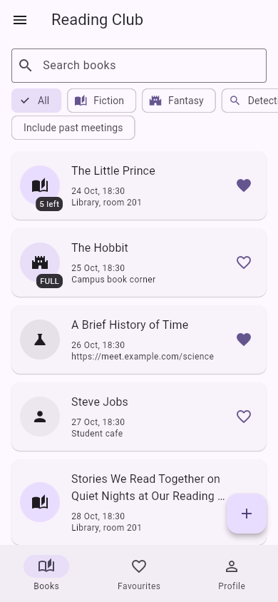
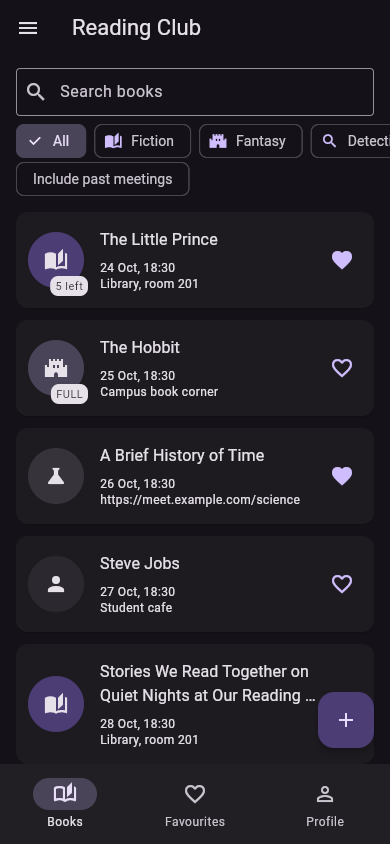
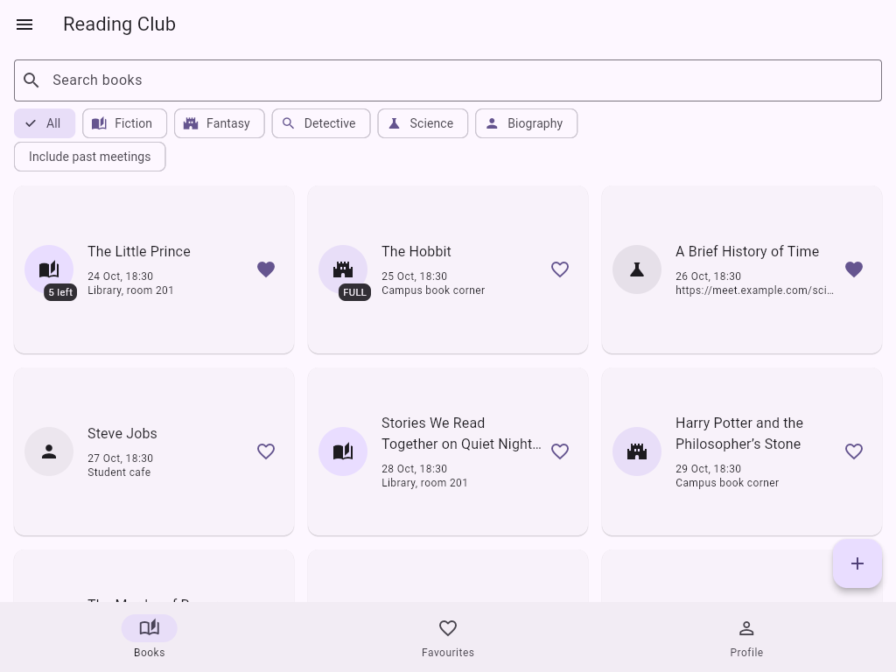

# Reading Club

Лабораторная работа по Dart и Flutter, тема — читательский клуб. Можно выбрать книгу, взять свободный экземпляр и посмотреть дату встречи. Все изменения хранятся в памяти и пропадают после перезапуска приложения.

## Запуск

Из папки `Lab1`:

```sh
flutter pub get
flutter run
```

Для запуска в браузере:

```sh
flutter run -d chrome
```

Проект проверен на Flutter 3.47.6 и Dart 3.13.5. Дополнительные пакеты для приложения не используются.

## Возможности

- 12 книг и 5 жанров, поиск по названию, фильтры жанра и прошедших встреч.
- Избранное и список книг, который становится сеткой при ширине от 600 пикселей.
- Подробности книги, обратный отсчёт до встречи, читатели и выдача или возврат экземпляра.
- Добавление, редактирование и удаление книг с подтверждениями.
- Проверка формы, выбор даты и времени, защита несохранённых изменений.
- Профиль читателя, группа, светлая, тёмная и системная темы.
- Меню с информацией о приложении и сбросом данных.

Сначала нужно сохранить имя и группу во вкладке Profile. Формат группы: `IT-2301`. Для онлайн-встречи вместо места вводится ссылка с `://`. Онлайн-ссылки в начальных данных служат примерами.

В начальных данных есть книга с названием ровно из 60 символов, книга без свободных экземпляров, прошедшие встречи, онлайн-встречи и книга без описания.

## Структура

- `lib/models/` — книга, жанр, профиль и состояния обратного отсчёта.
- `lib/data/seed.dart` — начальные книги с датами относительно текущего дня.
- `lib/screens/` — оболочка, три вкладки, подробности и форма книги.
- `lib/widgets/` — общие карточка, список и пустое состояние.
- `lib/utils/format.dart` — форматирование даты и времени без пакетов.
- `lib/routes.dart` — названия маршрутов и классы их аргументов.

## Decisions

Список книг и профиль находятся в `State` оболочки, потому что они нужны нескольким вкладкам. Вкладки получают данные через конструкторы и передают изменения наверх через callbacks. Экран подробностей тоже получает callbacks, чтобы сразу обновлять выдачу и удаление книги в общем списке. Форма возвращает новую книгу через `Navigator.pop`, поэтому при выходе без сохранения исходная книга не меняется. `LayoutBuilder` выбирает список или сетку по ширине родителя, а не по ширине всего устройства. `PopScope` сравнивает текущие поля с исходными значениями, и если вернуть все значения обратно, форма снова считается чистой. После изучения управления состоянием на 9-й неделе я бы вынес книги и профиль в отдельный объект состояния, чтобы передавать меньше callbacks.

## Скриншоты

Снимки приложения в браузере: телефон 390 × 844 и планшет 1024 × 768.

### Телефон — светлая тема



### Телефон — тёмная тема



### Планшет — сетка



## Проверка

```sh
flutter analyze
dart format . --output=none --set-exit-if-changed
flutter build web --no-web-resources-cdn
```

Автоматические тесты не добавлены, как указано в задании. Через интерфейс проверены создание и редактирование книги, валидация, отмена изменений, выдача и возврат, профиль, темы и сетка.
